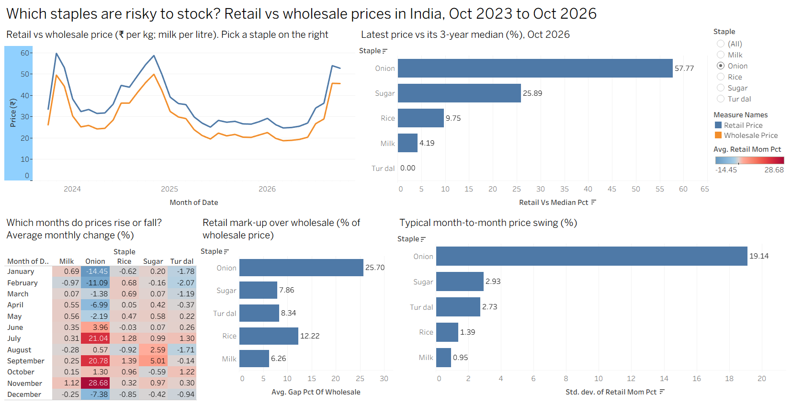

# Price & Demand Tracker: which essential staples are risky to stock?

**Question:** A retailer buys rice, tur dal, sugar, milk and onion every week. Which of these prices stay steady, which swing wildly, and when? That decides what to stock in bulk, what to promote, and when to buy.

**Live dashboard:** [View on Tableau Public](https://public.tableau.com/views/price_dashboard_17944750387040/Staplespricerisk?:language=en-US&:display_count=n&:origin=viz_share_link)

## Key findings

- **Onion is in a class of its own.** Its typical month-to-month price swing is about 19%, against 0.9% for milk, 1.4% for rice, 2.7% for tur dal and 2.9% for sugar.
- **Onion has a clear seasonal pattern.** Over three years its retail price rose on average by 21.0% in July, 20.8% in September and 28.7% in November, and fell by 14.5% in January and 11.1% in February.
- **Sugar and onion are expensive right now.** In October 2026 the retail price was 57.8% above its 3-year median for onion and 25.9% above for sugar. Rice is 9.8% above, milk 4.2% above, and tur dal is at its median.
- **Retail mark-up over wholesale differs a lot.** On average, onion retails 25.7% above wholesale, rice 12.2%, tur dal 8.3%, sugar 7.9% and milk 6.3%.

## What a retailer could do with this

- **Milk and rice:** prices barely move, so stock normally and keep shelf prices steady. They are safe items to build customer trust.
- **Onion:** keep stock small and buy often. Expect price rises around July, September and November, so avoid large purchases just before those months and be ready to adjust the shelf price.
- **Sugar:** it is well above its normal level now, so avoid bulk buying at today's price and avoid deep promotions that cannot be sustained.
- **Tur dal:** at its normal level now, a reasonable time to buy for regular needs.

These are suggestions drawn from past price patterns. They do not predict the future.

## Data

- **Source:** Department of Consumer Affairs, Price Monitoring System (fcainfoweb.nic.in), report "Variation Report for Selected Time Span", Daily All India Average (Retail and Wholesale).
- **Coverage:** 41 commodities, but this project focuses on 5 staples: rice, tur/arhar dal, sugar, milk and onion.
- **Time:** the price on the 15th of every month from October 2023 to October 2026 (37 months per staple), plus October 2021 and 2022 for context.
- The site only lets you download a few time spans at a time, so the data was collected in 8 downloads (kept in `data/raw/snapshots`).

## How the data was cleaned

1. The downloads are saved with an `.xls` name but are really HTML tables. I read them with pandas and combined them (`scripts/build_dataset.py`).
2. Each report had separate retail and wholesale columns, with dates as column headings. I turned them into one tidy table: one row per date, commodity and price type.
3. Wholesale prices come in rupees per quintal. I divided by 100 to get rupees per kg, so retail and wholesale can be compared. Milk is in rupees per litre.
4. I removed duplicate rows, and stripped markers such as `@` and `*` from commodity names.
5. Result: 3,198 rows, 41 commodities, 39 dates, no missing values for the five staples (`data/clean/prices_long.csv`).
6. `scripts/make_dashboard_data.py` then builds one file with 185 rows (5 staples x 37 months) for the dashboard, with monthly change, retail-wholesale gap and distance from the 3-year median.

## How each measure is worked out

- **Volatility:** standard deviation of the month-on-month % change in retail price.
- **Mark-up:** (retail - wholesale) / wholesale, averaged over all months.
- **Seasonality:** average month-on-month % change for each calendar month.
- **Price vs normal:** latest retail price compared with the median of the last 3 years.

## Limits to keep in mind

- These are all-India averages. Prices in your own city or shop can be different.
- Only one price per month (the 15th) is used, so short spikes between those dates are not visible.
- Seasonality uses only 3 years. For example, the onion November figure is dominated by one big event in 2023, so treat it as a pattern to watch and not as a rule.
- Weekend and holiday prices on the source site are provisional.

## Project files

| Folder | What is in it |
|---|---|
| `data/raw/snapshots` | The 8 original downloads |
| `data/clean` | Cleaned and dashboard-ready CSV files |
| `scripts` | Python scripts that build the datasets |
| `notebooks` | `01_price_analysis.ipynb`, the full analysis with charts |
| `dashboard` | Tableau workbook |
| `images` | Charts and dashboard screenshot |

## Tools

Python (pandas, matplotlib, seaborn), Tableau Public, Git and GitHub.
